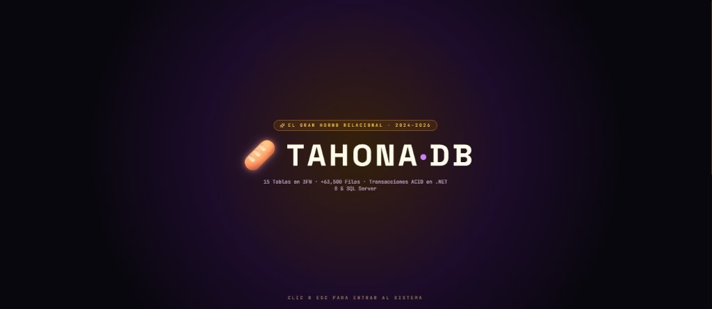
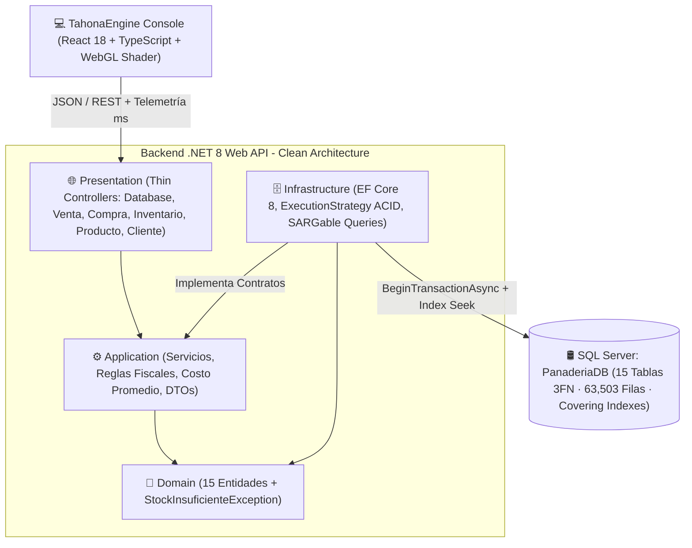
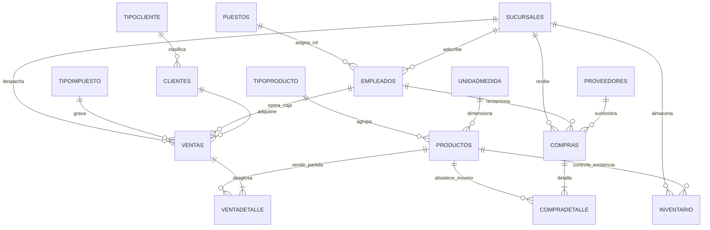
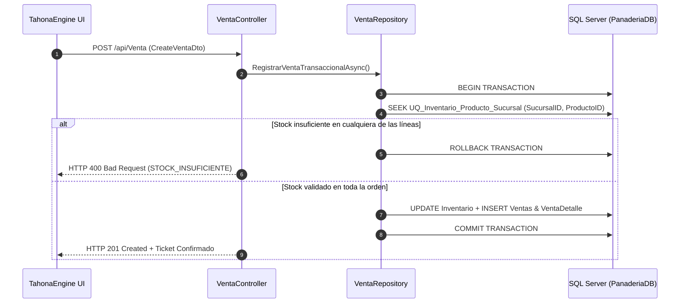

# 🥖 TahonaEngine · Panificadora Tanajara DB & ERP OS



[](https://dotnet.microsoft.com/)
[](https://www.microsoft.com/sql-server)
[](https://react.dev/)
[](https://www.typescriptlang.org/)
[](https://tailwindcss.com/)
[](https://github.com/ElorichV/Sistema-de-gestion-para-panaderias/actions/workflows/ci.yml)
[](LICENSE)

Sistema de ingeniería de bases de datos relacionales, punto de venta (POS) y abastecimiento multi-sucursal para una cadena de panaderías artesanales con **3 años de operación continua (2024 a 2026)**. Combina un backend en **.NET 8 Clean Architecture + Entity Framework Core** sobre **Microsoft SQL Server (15 tablas en 3FN y 63,503 registros)** con **TahonaEngine**, una consola técnica en React, TypeScript y WebGL diseñada para inspeccionar el motor relacional, sus índices y sus transacciones ACID en tiempo real.

> 📐 **Atlas Completo de Mapas de Base de Datos:** Consulta [`docs/DATABASE_MAPS.md`](docs/DATABASE_MAPS.md) para ver en detalle los 5 diagramas formales (E-R Crow's Foot completo, Dependencias 3FN, Secuencia ACID, Índices B-Tree `INCLUDE` y Estrella Analítica OLAP), también integrados de forma interactiva en la pestaña **Esquema 15 Tablas** de la aplicación.

---

## 🏗️ Arquitectura del Sistema



---

## 📐 Mapa Entidad-Relación (15 Tablas en 3FN)



---

## 🔒 Flujo Transaccional ACID y Concurrencia



---

## 🗄️ Ingeniería de Datos Destacada

1. **Dataset Empresarial de 3 Años (`2024-01-01` a `2026-11-24`):**
   - El script [`database/PanaderiaDB_3Anios_EnterpriseSeed.sql`](database/PanaderiaDB_3Anios_EnterpriseSeed.sql) genera en segundos mediante CTEs deterministas **63,503 registros**:
     - `15,612` tickets en `Ventas` y `42,152` partidas en `VentaDetalle` con columna calculada `Importe AS (Cantidad * PrecioUnitario)` reconciliada al centavo.
     - `1,323` órdenes en `Compras` y `3,969` líneas en `CompraDetalle` que alimentan el **Costo Promedio Ponderado**.
     - `240` registros en `Inventario` (5 sucursales × 48 SKUs), con productos agotados intencionales en Matriz Centro para demostrar el rollback `HTTP 400` en vivo.
     - **Estacionalidad real:** picos en enero (*Rosca de Reyes Artesanal*) y octubre-noviembre (*Pan de Muerto Azahar & Naranja*).
2. **Índices Cubrientes y Consultas SARGables:**
   - `IX_Ventas_FechaHora_Sucursal INCLUDE (Total, Subtotal, TotalImpuestos, Estatus, ClienteID)`
   - `IX_VentaDetalle_ProductoID INCLUDE (VentaID, Cantidad, PrecioUnitario)`
   - `IX_Compras_FechaRecepcion_Sucursal INCLUDE (Total, ProveedorID)`
   - Filtros por rango directo (`FechaHora >= inicio && FechaHora < fin`) combinados con `.AsNoTracking()` para evitar escaneos completos de tabla.

---

## ✨ Módulos de la Consola TahonaEngine (`panaderia-frontend`)

- **Observatorio 3 Años:** KPIs con sparklines SVG, curva interactiva de 36 meses, ranking por sucursal, inspector de receta y consola SQL.
- **Esquema 15 Tablas + Atlas E-R:** Lienzo interactivo en notación Crow's Foot de las 15 tablas, secuencia ACID, arquitectura B-Tree e inspector DBA (`SQL DDL`, `Índices / EF Core` y rendimiento).
- **Endpoints & ACID Lab:** Workbench integrado para ejecutar endpoints en vivo, medir latencia en milisegundos y comparar un `201 COMMIT` contra un `400 ROLLBACK`.
- **La Tahona POS:** Vitrina artesanal con stock por horno, selector de régimen fiscal (`IVA 16%`, `Tasa 0%`, `IEPS 8%`) y emisión de ticket.
- **Almacén & Molinos:** Control de harinas de fuerza e insumos con horneado rápido y recepción transaccional de compras a proveedores.

---

## 🔌 Endpoints Principales (.NET 8 Web API)

| Método | Ruta | Propósito Técnico |
| :--- | :--- | :--- |
| `GET` | `/api/health` | Verificación de conectividad a `PanaderiaDB` y estado del motor |
| `GET` | `/api/Database/telemetry` | Conteo en vivo de las 15 tablas, valuación de stock y horizonte temporal |
| `GET` | `/api/Database/analytics?anio=&sucursalId=` | Series mensuales de 3 años, ranking de sucursales y top productos (SARGable) |
| `GET` | `/api/Database/catalogos` | Bundle de catálogos 3FN (Sucursales, Empleados, Proveedores, Impuestos, Unidades) |
| `GET` / `POST` | `/api/Venta` | Consulta paginada de tickets y procesamiento transaccional ACID con descuento de stock |
| `GET` / `POST` | `/api/Compra` | Historial de abastecimiento y recepción atómica con recálculo de `CostoPromedio` |
| `GET` / `POST` | `/api/Inventario` | Existencias globales, filtro `/sucursal/{id}` y ajuste `/actualizar-stock` |
| `GET` / `POST` / `PUT` / `DELETE` | `/api/Producto` | Gestión del catálogo artesanal y borrado lógico (`EsVendible = false`) |
| `GET` / `POST` / `PUT` / `DELETE` | `/api/Cliente` | Gestión de cartera mostrador, convenios hoteleros/restaurantes y VIP |

---

## 🚀 Puesta en Marcha Local

### 1. Base de Datos (SQL Server)
```powershell
sqlcmd -S "localhost" -E -C -i "database\PanaderiaDB_3Anios_EnterpriseSeed.sql"
```
Si usas una instancia nombrada local (por ejemplo `localhost\SQL2025` o `localhost\SQLEXPRESS`), configúrala mediante User Secrets sin modificar el repositorio:
```powershell
cd Panaderia
dotnet user-secrets set "ConnectionStrings:DefaultConnection" "Server=localhost\SQL2025;Database=PanaderiaDB;Trusted_Connection=True;TrustServerCertificate=True;"
```

### 2. Backend (.NET 8)
```powershell
cd Panaderia
dotnet run --launch-profile http
```
- API activa en `http://localhost:5064` · Swagger UI en `http://localhost:5064/swagger`

### 3. Frontend (React + Vite)
```powershell
cd panaderia-frontend
npm install
npm run dev
```
- Consola interactiva en `http://localhost:5173`

---

## 📄 Licencia

Distribuido bajo licencia **MIT**. Consulta [LICENSE](LICENSE) para más detalles.
