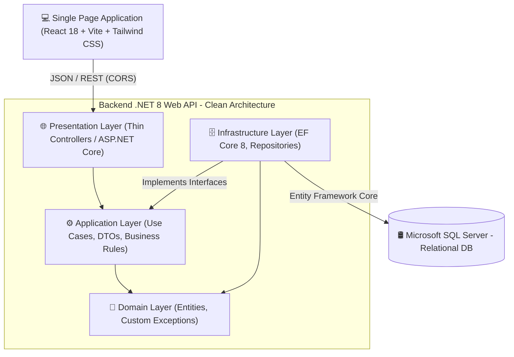

# 🥖 Panificadora Tanajara | Sistema Integral POS & Control de Inventario

[](https://dotnet.microsoft.com/)
[](https://react.dev/)
[](https://www.typescriptlang.org/)
[](https://vitejs.dev/)
[](https://tailwindcss.com/)
[](https://www.microsoft.com/sql-server)
[](https://github.com/ElorichV/Sistema-de-gestion-para-panaderias/actions/workflows/ci.yml)
[](LICENSE)

Sistema empresarial **Fullstack** diseñado para la gestión operativa, punto de venta (POS) y control de existencias multinsumo para cadenas de panaderías y reposterías. Construido bajo **Clean Architecture**, principios **SOLID**, transacciones atómicas **ACID** en base de datos y un cliente web desacoplado con **React + Vite**.

---

## 📌 Tabla de Contenidos

- [Resumen Arquitectónico](#-resumen-arquitectónico)
- [Decisiones de Diseño y Reglas de Negocio](#-decisiones-de-diseño-y-reglas-de-negocio)
- [Stack Tecnológico](#-stack-tecnológico)
- [Estructura de la Solución](#-estructura-de-la-solución)
- [API REST Contracts & Endpoints](#-api-rest-contracts--endpoints)
- [Instalación y Puesta en Marcha](#-instalación-y-puesta-en-marcha)
  - [1. Configuración de Base de Datos](#1-configuración-de-base-de-datos)
  - [2. Backend (JetBrains Rider / .NET CLI)](#2-backend-jetbrains-rider--dotnet-cli)
  - [3. Frontend (JetBrains WebStorm / Vite Dev)](#3-frontend-jetbrains-webstorm--vite-dev)
- [Aseguramiento de Calidad y Verificación](#-aseguramiento-de-calidad-y-verificación)
- [Próximos Pasos (Roadmap)](#-próximos-pasos-roadmap)

---

## 🏗️ Resumen Arquitectónico

La solución desacopla radicalmente el **Core de Negocio** de la infraestructura tecnológica y la capa de presentación:



### Principios y Patrones Aplicados:
* **Clean Architecture (Onion / Hexagonal):** El dominio no posee dependencias externas; las abstracciones e interfaces de repositorios residen en la capa de Aplicación/Dominio.
* **Thin Controllers:** Los controladores de API se limitan a recibir el payload HTTP, validar el modelo, delegar al servicio de aplicación y retornar códigos de estado semánticos (`200 OK`, `201 CreatedAtAction`, `400 BadRequest`, `404 NotFound`).
* **DTO-First (Anti-Mass Assignment):** Ninguna entidad de dominio de Entity Framework se expone directamente hacia el cliente HTTP, mitigando fugas de datos y bucles de serialización cíclica.
* **Transacciones ACID con Rollback Atómico:** Uso de `IDbContextTransaction` con `strategy.ExecuteAsync(...)` para garantizar que no existan descuentos parciales si se agota el stock o ocurre una falla de red.
* **Optimización de Lecturas (`database-mastery`):** Consultas marcadas con `.AsNoTracking()` para minimizar la sobrecarga del *Change Tracker* de EF Core, y uso de índices compuestos `UQ_Inventario_Producto_Sucursal` para búsquedas en tiempo logarítmico.

---

## 💡 Decisiones de Diseño y Reglas de Negocio

### 1. Descuento Atómico y Validación de Stock
En un entorno concurrente de panadería, dos cajeros pueden intentar vender la última baguette en vitrina al mismo tiempo. El servicio [`VentaService`](file:///c:/Proyectos/Proyecto%20Panaderia/Panaderia.Application/Services/VentaService.cs) y el repositorio [`VentaRepository`](file:///c:/Proyectos/Proyecto%20Panaderia/Panaderia.Infrastructure/Persistence/Repositories/VentaRepository.cs) gestionan esto mediante:
* **Aislamiento Transaccional:** Bloqueo de fila y verificación de existencia antes de insertar la cabecera.
* **Excepción de Dominio Específica:** Si `inventario.CantidadStock < solicitado`, se dispara [`StockInsuficienteException`](file:///c:/Proyectos/Proyecto%20Panaderia/Panaderia.Domain/Exceptions/StockInsuficienteException.cs), la cual aborta la transacción (`RollbackAsync`) y devuelve al cliente un error estructurado:
  ```json
  {
    "codigo": "STOCK_INSUFICIENTE",
    "mensaje": "Stock insuficiente para 'Baguette Rústica' (ID: 2). Stock disponible: 3.00, Solicitado: 5.00.",
    "productoId": 2,
    "stockDisponible": 3.0,
    "cantidadSolicitada": 5.0
  }
  ```

### 2. Motor Fiscal y Financiero
* Cálculo estricto de `Subtotal`, `TotalImpuestos` (IVA 16% configurable vía lookup `TipoImpuesto`) y `Total` a pagar con redondeo bancario (`MidpointRounding.AwayFromZero`) para evitar discrepancias de centavos.
* Columna persistida/calculada en `VentaDetalle.Importe = Cantidad * PrecioUnitario`.

### 3. Borrado Lógico (Soft Delete)
* La desactivación de productos preserva la integridad referencial histórica de ventas y compras asignando `EsVendible = false` en lugar de eliminar el registro físico.

---

## 🛠️ Stack Tecnológico

| Capa / Ecosistema | Tecnología | Propósito |
| :--- | :--- | :--- |
| **Backend Framework** | .NET 8.0 LTS / C# 12 | Core empresarial de alto rendimiento y tipado fuerte |
| **Acceso a Datos (ORM)** | Entity Framework Core 8.0.11 | Mapeo relacional, migraciones y ejecución transaccional |
| **Base de Datos** | Microsoft SQL Server (2019/2022/2025) | Motor relacional con integridad referencial e índices únicos |
| **Documentación API** | Swagger / OpenAPI (Swashbuckle 6.6) | Contrato interactivo y sandbox de pruebas HTTP |
| **Frontend Framework** | React 18.3 + TypeScript | SPA modular, reactiva y orientada a componentes |
| **Build Tooling** | Vite 5.4 | Empaquetador ultrarrápido con ESM nativo y HMR |
| **Estilos & UI** | Tailwind CSS 3.4 + Lucide Icons | Diseño responsive mobile-first con estética artesanal moderna |
| **IDEs Recomendados** | JetBrains Rider & JetBrains WebStorm | Experiencia de desarrollo (DX) profesional fullstack |

---

## 📂 Estructura de la Solución

```
c:\Proyectos\Proyecto Panaderia\
├── Panaderia.sln                      # Solución principal en .NET 8
│
├── Panaderia/                         # Capa de Presentación (Web API)
│   ├── Controllers/                   # Thin Controllers (Venta, Producto, Inventario, Cliente)
│   ├── Properties/launchSettings.json # Perfiles HTTP (5064) y HTTPS (7087)
│   ├── appsettings.json               # Configuración y ConnectionStrings
│   └── Program.cs                     # Contenedor IoC, CORS y Pipeline HTTP
│
├── Panaderia.Application/             # Capa de Aplicación (Casos de Uso)
│   ├── DTO'S/                         # DTOs de Entrada/Salida (Venta, Producto, Inventario)
│   ├── Interfaces/                    # Contratos de Servicios y Repositorios
│   └── Services/                      # VentaService, ProductoService, InventarioService
│
├── Panaderia.Domain/                  # Capa de Dominio (Núcleo Puro)
│   ├── Entities/                      # Entidades (Producto, Venta, Inventario, etc.)
│   └── Exceptions/                    # DomainException, StockInsuficienteException
│
├── Panaderia.Infrastructure/          # Capa de Infraestructura (Persistencia)
│   └── Persistence/
│       ├── Contexts/                  # PanaderiaDbContext (Fluent API)
│       └── Repositories/              # Implementaciones EF Core y transacciones ACID
│
└── panaderia-frontend/                # Cliente Web SPA Desacoplado
    ├── src/
    │   ├── components/                # Navbar, CatalogView, CartView, StockDashboard, ReceiptModal
    │   ├── services/api.ts            # Cliente HTTP con fallback resiliente
    │   ├── types/api.ts               # Contratos TypeScript sincronizados con los DTOs de .NET
    │   ├── App.tsx                    # Orquestador del estado global del POS
    │   └── main.tsx                   # Punto de entrada React 18
    ├── vite.config.ts                 # Proxy inverso a http://localhost:5064/api
    └── tailwind.config.js             # Paleta temática de panadería (Warm Amber/Stone)
```

---

## 🔌 API REST Contracts & Endpoints

La API cumple con estándares REST y negociación de contenido JSON:

### Ventas (`/api/Venta`)
* `GET /api/Venta` ➔ `200 OK`: Lista de ventas históricas con relaciones incluidas (cajero, sucursal, cliente e items).
* `GET /api/Venta/{id}` ➔ `200 OK`: Detalle de una venta o `404 Not Found`.
* `POST /api/Venta` ➔ `201 Created`: Registra una venta atómica. Descuenta stock de `Inventario`. Retorna `VentaResponseDto` con URI en el header `Location`.

#### Payload de entrada (`CreateVentaDto`):
```json
{
  "sucursalId": 1,
  "empleadoId": 1,
  "clienteId": 2,
  "tipoImpuestoId": 1,
  "detalles": [
    { "productoId": 1, "cantidad": 2, "precioUnitario": 14.50 },
    { "productoId": 2, "cantidad": 1, "precioUnitario": 32.00 }
  ]
}
```

### Inventario (`/api/Inventario`)
* `GET /api/Inventario` ➔ `200 OK`: Existencias globales consolidadas.
* `GET /api/Inventario/sucursal/{sucursalId}` ➔ `200 OK`: Stock detallado por sucursal.
* `POST /api/Inventario/actualizar-stock` ➔ `200 OK`: Reabastece o fija stock de almacén (`operacion: "reabastecer" | "fijar"`).

### Catálogo de Productos (`/api/Producto`)
* `GET /api/Producto` ➔ `200 OK`: Vitrina de productos con stock acumulado y unidad de medida.
* `POST /api/Producto` ➔ `201 Created`: Registra nuevo producto en catálogo.
* `PUT /api/Producto/{id}` ➔ `200 OK`: Actualiza ficha técnica o precio.
* `DELETE /api/Producto/{id}` ➔ `200 OK`: Borrado lógico (`EsVendible = false`).

---

## 🚀 Instalación y Puesta en Marcha

### 1. Configuración de Base de Datos
El proyecto cuenta con el script DDL y DML completo en [`Base de datos.txt`](file:///c:/Proyectos/Proyecto%20Panaderia/Base%20de%20datos.txt).
Asegúrate de que la cadena de conexión en `Panaderia/appsettings.json` apunte a tu servidor SQL Server local:

```json
{
  "ConnectionStrings": {
    "DefaultConnection": "Server=localhost\\SQL2025;Database=PanaderiaDB;Trusted_Connection=True;TrustServerCertificate=True;"
  }
}
```

### 2. Backend (JetBrains Rider / .NET CLI)

#### Vía JetBrains Rider:
1. Abre [Panaderia.sln](file:///c:/Proyectos/Proyecto%20Panaderia/Panaderia/Panaderia.sln).
2. Selecciona la configuración de ejecución **`Panaderia.Api: http`**.
3. Presiona **Run ▶️** (`Shift + F10`).
4. La API iniciará en `http://localhost:5064` y abrirá la documentación Swagger en:
   👉 `http://localhost:5064/swagger`

#### Vía Terminal CLI:
```powershell
cd "c:\Proyectos\Proyecto Panaderia\Panaderia"
dotnet restore
dotnet run --launch-profile http
```

---

### 3. Frontend (JetBrains WebStorm / Vite Dev)

#### Vía JetBrains WebStorm:
1. Abre la carpeta [panaderia-frontend](file:///c:/Proyectos/Proyecto%20Panaderia/panaderia-frontend).
2. En la barra inferior de npm, haz doble clic en el script **`dev`** (o abre la terminal integrada con `Alt + F12`).
3. Haz clic en la URL generada: `http://localhost:5173`.

#### Vía Terminal CLI:
```powershell
cd "c:\Proyectos\Proyecto Panaderia\panaderia-frontend"
npm install
npm run dev
```

> **Verificación de conexión en vivo:** En la barra de navegación del frontend observarás el indicador **`● API .NET Conectada`**, lo que confirma que el proxy inverso de Vite está resolviendo peticiones contra `localhost:5064`.

---

## 🧪 Aseguramiento de Calidad y Verificación

El proyecto sigue un estricto protocolo de calidad (**Verification Loop**):

1. **Compilación Limpia Backend (.NET 8):**
   ```powershell
   dotnet build --no-incremental "Panaderia\Panaderia.sln"
   # Salida esperada: 0 Advertencia(s), 0 Errores
   ```

2. **Tipado y Compilación Frontend (TypeScript & Vite):**
   ```powershell
   cd panaderia-frontend
   npm run build
   # Salida esperada: ✓ built in ~9s, 0 TypeScript errors
   ```

3. **Pruebas de Resiliencia en Venta Concurrente:**
   * La interfaz de usuario detecta de inmediato respuestas `400 Bad Request` disparadas por `StockInsuficienteException` y muestra una alerta visual sin degradar la experiencia de usuario.

---

## 🗺️ Próximos Pasos (Roadmap)

- [ ] **Autenticación & Autorización:** Implementación de JWT (JSON Web Tokens) con roles de `Cajero`, `Gerente de Sucursal` y `Administrador`.
- [ ] **Docker Compose:** Orquestación en contenedores para `sql-server`, `panaderia-api` y `nginx` para el frontend.
- [ ] **Caché Distribuida con Redis:** Almacenamiento en memoria para el catálogo de productos con invalidación por eventos.
- [ ] **Testing Automatizado:** Suite de pruebas unitarias en xUnit + FluentAssertions y pruebas E2E con Playwright.

---

## 📄 Licencia

Este proyecto se distribuye bajo la licencia **MIT**. Consulta el archivo [LICENSE](LICENSE) para más información.

Desarrollado con dedicación profesional para panaderías artesanales y operaciones comerciales modernas. 🥖☕
