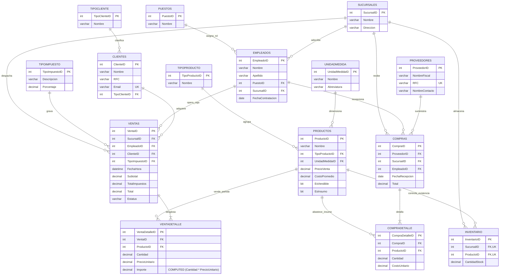
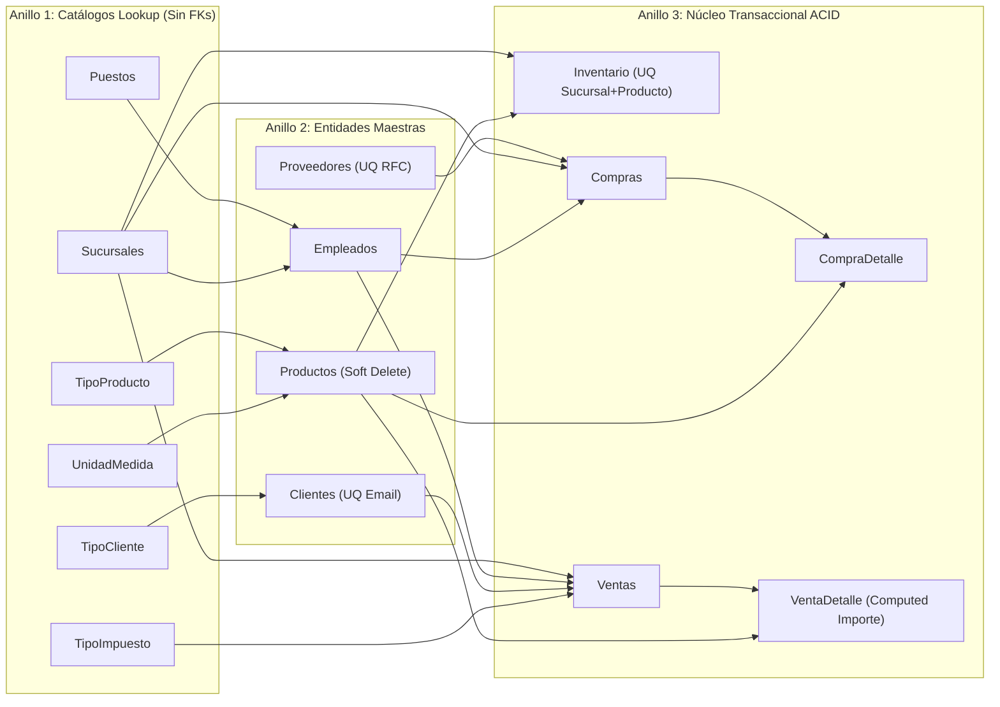
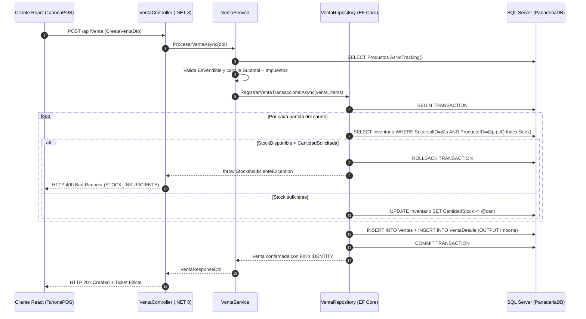
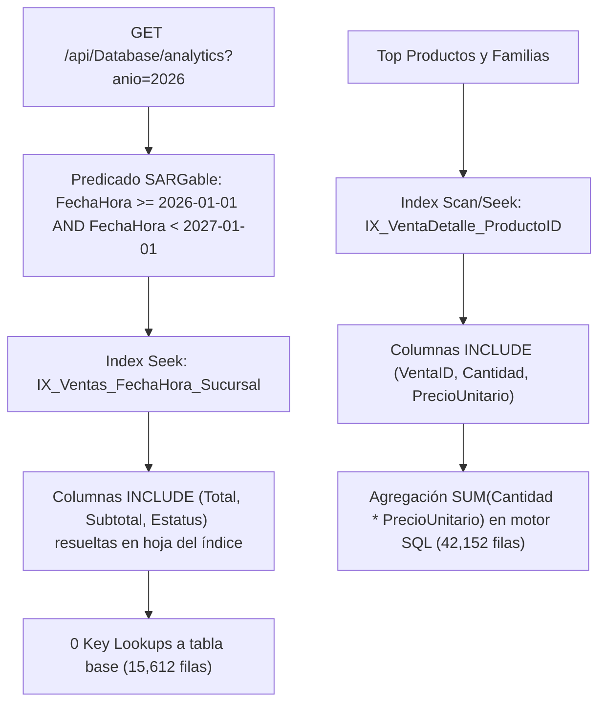
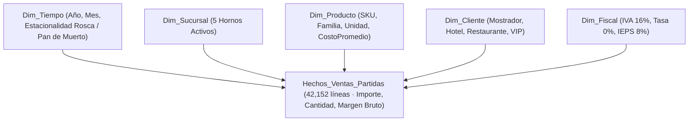

# 🗺️ Atlas de Arquitectura y Mapas de Base de Datos (`PanaderiaDB`)

Este documento concentra los **5 mapas formales de ingeniería de datos** del sistema **TahonaEngine · Panificadora Tanajara**:

1. **Diagrama Entidad-Relación Completo (Crow's Foot · 15 Tablas en 3FN)**
2. **Mapa Topológico de Dependencias e Integridad Referencial**
3. **Mapa de Secuencia Transaccional ACID y Control de Concurrencia**
4. **Mapa Físico de Índices Cubrientes (`INCLUDE`) y SARGability**
5. **Mapa de Linaje Analítico (Proyección Estrella OLTP → OLAP)**

---

## 1. Diagrama Entidad-Relación (15 Tablas en 3FN)

---

## 2. Mapa Topológico de Dependencias (Orden DDL y Protección Referencial)

Todas las llaves foráneas operan bajo restricción `NO ACTION` (`DeleteBehavior.ClientSetNull` en EF Core) combinada con **Borrado Lógico (`EsVendible = 0`)** en `Productos` para impedir pérdida accidental de historia contable.

---

## 3. Mapa de Secuencia Transaccional ACID (`POST /api/Venta`)

---

## 4. Mapa Físico de Indexación B-Tree y SARGability

---

## 5. Mapa Estrella de Linaje Analítico (OLTP 3FN → Proyección OLAP)

